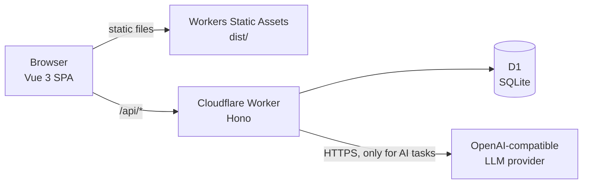

# NovelForge

**An AI-assisted workbench for long-form fiction that remembers your book, so you don't have to paste it into a chat.**

[简体中文](README.zh-CN.md)


Serial novels run for hundreds of chapters. Chat-based AI tools forget who died in chapter 9, which cultivation level the hero reached, and which foreshadowing still needs a payoff. NovelForge keeps that knowledge inside the book: character and setting cards, memory, foreshadowing, and chapter summaries. The relevant parts are put into the prompt automatically when you write the next chapter, and every chapter can be checked against the story so far.

NovelForge is the MIT-licensed community edition of a larger writing app. You bring your own OpenAI-compatible model key. There is no hosted model, no subscription, and no feature gating.

<!--
## Screenshots


-->

## Features

**Writing**
- Bookshelf with volumes and chapters, plus world notes and outlines at book, volume, and chapter level
- Streaming chapter generation (NDJSON); a partial draft is saved even if the browser disconnects
- Chat with the AI about a book, apply its suggestions, or create a new book (volumes, outlines, cards) from a chat
- Reading view and full-text search within a book

**Story memory**
- Character cards and setting cards, with per-card history
- Memory extraction after each chapter: proposed changes are reviewed and confirmed before they are saved
- Foreshadowing tracker with reminders as the planned payoff chapter approaches
- Automatic chapter summaries

**Quality and safety nets**
- Consistency check that flags contradictions with the book so far, located to the paragraph
- A test set of chapters with planted errors (seeded with samples) to measure how well the checker catches them
- Versions and rollback for chapters and cards

**Data and accounts**
- Export a chapter as text, or the whole book as a zip (Markdown chapters plus YAML outline, memory, foreshadowing, summaries)
- Per-book stats
- Open sign-up; the first account becomes admin, and `ALLOW_REGISTRATION=false` closes sign-up
- English UI by default, Simplified Chinese available from the language switch

## Tech stack

| Layer | Technology |
| --- | --- |
| Frontend | Vue 3, Vite, Vue Router, Element Plus, vue-i18n |
| Backend | Hono on Cloudflare Workers |
| Database | Cloudflare D1 (SQLite) with Drizzle ORM |
| Hosting | Workers Static Assets serves the Vite build |
| Tests | Node.js test runner (`node:test`) with Miniflare |

## Architecture



- Only `/api/*` reaches the Worker (`run_worker_first` in `wrangler.jsonc`). Other routes are static files, with SPA fallback to `index.html`.
- Writing data lives in D1. Tables use a `cj_` prefix and every row is scoped to the signed-in user.
- `POST /api/changjuan/chapters/:id/generate` streams NDJSON events: `context`, then `reasoning` and `delta` chunks, then `done` or `error`. The Worker keeps reading the model after the client disconnects and saves what it has as a draft.
- Auth: PBKDF2-SHA256 password hashes (50,000 iterations), HS256 JWTs valid for 14 days, and in-memory login rate limiting.

## Getting started

**Prerequisites:** Node.js 22 or newer. A Cloudflare account is only needed to deploy.

```bash
git clone https://github.com/longxiang-io/novelforge.git
cd novelforge
npm install

# Local secrets. Set JWT_SECRET and ENCRYPTION_KEY to random strings (16+ characters):
#   node -e "console.log(require('crypto').randomBytes(32).toString('hex'))"
cp .dev.vars.example .dev.vars

# Create the local D1 database schema (no Cloudflare account needed)
npm run db:migrate:local

# Build the frontend, then start the Worker locally
npm run build
npm run dev
```

`npm run dev` runs `wrangler dev --local`, which serves the API and the pages from `dist/` (by default on http://localhost:8787). Run `npm run build` again after frontend changes.

Register the first account in the app; it becomes the admin. Then open **Settings** and add a model provider and key.

| Script | What it does |
| --- | --- |
| `npm run dev` | Worker + static assets locally (`wrangler dev --local`) |
| `npm run build` | Vite production build into `dist/` |
| `npm test` | All tests in `test/` with `node --test` (local Miniflare D1, no network) |
| `npm run db:migrate:local` | Apply `migrations/` to the local D1 database |

## Deploy to Cloudflare

1. Create the database and copy the printed id into `d1_databases[0].database_id` in `wrangler.jsonc` (keep the binding `DB`):
   ```bash
   npx wrangler d1 create novelforge
   ```
2. Apply migrations to the remote database:
   ```bash
   npx wrangler d1 migrations apply DB --remote
   ```
3. Set the secrets:
   ```bash
   npx wrangler secret put JWT_SECRET
   npx wrangler secret put ENCRYPTION_KEY
   ```
4. Build and deploy:
   ```bash
   npm run build
   npx wrangler deploy
   ```

After you have registered your own account, set `ALLOW_REGISTRATION` to `false` (in `wrangler.jsonc` or the Cloudflare dashboard) if the instance is private.

## Configuration

| Name | Where | Required | Description |
| --- | --- | --- | --- |
| `JWT_SECRET` | `.dev.vars` / `wrangler secret put` | Yes | Signs login tokens. At least 16 characters. |
| `ENCRYPTION_KEY` | `.dev.vars` / `wrangler secret put` | Yes | Encrypts model keys saved on the server. At least 16 characters. |
| `ALLOW_REGISTRATION` | `wrangler.jsonc` `vars` (`.dev.vars` overrides locally) | No | Default `true`. `false`, `0`, `no`, or `off` close sign-up once a user exists. An empty database can always register the first admin. |
| `database_id` | `wrangler.jsonc` | For deploy | D1 database id from `wrangler d1 create`. |

Never commit `.dev.vars`; it is in `.gitignore`.

## Project structure

```text
novelforge/
├── src/            # Vue 3 app: views, router, locales (en, zh-CN), components
├── worker/         # Hono Worker: index.js, routes.js, auth.js
│   ├── api/        # One file per endpoint, e.g. chapters/[id]/generate.post.js
│   └── lib/        # LLM client, prompts, checker, memory, crypto, export
├── shared/         # Code used by both the app and the Worker
├── migrations/     # D1 SQL migrations
├── test/           # node:test suites
├── public/         # Static assets (favicon, avatars)
├── wrangler.jsonc  # Worker, assets and D1 config
└── vite.config.js
```

## Bring your own key and privacy

Each user adds up to five OpenAI-compatible providers in Settings and picks a model per task (generate, check, extract, summary, chat). Volcengine Ark is available as a preset. For each provider you choose where the key lives:

- **On the server:** encrypted with AES-256-GCM (key derived from `ENCRYPTION_KEY` via SHA-256). The API only ever returns whether a key is set and its last four characters.
- **In this browser only:** the key stays in `localStorage` and is sent with each model call in the `X-Provider-Keys` header. The Worker uses it for that request and never writes it to D1.

Your manuscript is sent to the provider you configure, and only when you run an AI task. NovelForge has no analytics or third-party calls of its own.

## Roadmap

- [ ] Admin screen to disable accounts (disabled accounts are already blocked from signing in, but there is no UI to set this yet)
- [ ] Translate the remaining Chinese model prompts, task and category labels, and API error messages

## Contributing

Issues and pull requests are welcome. Before opening a PR, please run `npm test` and `npm run build`, keep changes focused, and add UI text in both English and Chinese under `src/locales/`.

## License

[MIT](LICENSE) © 2026 Long Xiang ([@longxiang-io](https://github.com/longxiang-io))
