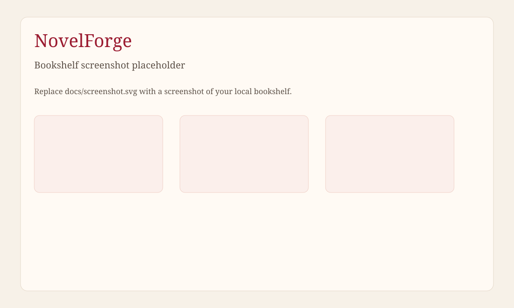

# NovelForge

NovelForge is a workbench for long-form serial fiction. The book keeps its own character cards, setting cards, foreshadows, and chapter summaries, so a later chapter can be written without pasting the whole manuscript into a chat box.

You bring your own OpenAI-compatible model key. NovelForge does not sell access or host a model for you.



## Features

- Bookshelf, volumes, and chapters
- Character cards and setting cards
- Memory that is injected into later chapters
- Foreshadows, with reminders as the planned chapter approaches
- Streaming chapter generation
- Consistency check against the book so far
- Chapter summaries
- Versions and rollback
- Export a confirmed chapter as text, or the confirmed book as a zip
- Usage stats
- Model settings, with your own key

The interface is English by default, with Chinese (`zh-CN`) available from the language switch. The choice is stored in `localStorage`.

## Tech stack

- Vue 3, Vite, Vue Router, Element Plus, vue-i18n
- Hono on a Cloudflare Worker
- Drizzle ORM queries against Cloudflare D1
- Node.js test runner (`node:test`) with Miniflare for the Worker tests

## Architecture

```text
browser (Vue)
    |
    |  /api/* 
    v
Hono Worker  ----  D1 (SQLite)
    |
    |  HTTPS, only when a task calls a model
    v
your OpenAI-compatible provider
```

The Vite build is a static site in `dist/`. The Worker serves it with Workers static assets. Browser routes fall back to `index.html`. Only `/api/*` is handled by the Worker.

Writing data lives in D1. Table names use a `cj_` prefix. Each row is scoped to the signed-in user.

### Streaming generation

`POST /api/changjuan/chapters/:id/generate` answers with NDJSON, not one JSON object. Events are `context`, then `reasoning` and `delta` chunks, then `done` or `error`. The Worker keeps reading the model after the browser disconnects, and saves whatever prose it already has as a draft.

### Bring your own model key

Each user stores providers and a model for each task (generate, check, extract, summary, chat) in Settings.

- **Save on the server.** The key is encrypted with AES-256-GCM. `ENCRYPTION_KEY` is hashed with SHA-256 to form the AES key. Stored values look like `enc:v1:<iv>:<tag>:<data>`. The API returns only whether a key is set, plus the last four characters.
- **Keep it in this browser.** The key stays in `localStorage` and is sent on model calls in the `X-Provider-Keys` header. The Worker uses it for that request and does not write it to D1.

If a task has no key or no model, the API returns HTTP 400 with `error_type: "not_configured"` before a stream starts. A browser-only provider with no key on this device returns `error_type: "local_key_missing"`.

### Accounts

Passwords are PBKDF2-SHA256 (50,000 iterations). Login accepts an email or a username and returns an HS256 JWT that lasts 14 days. The first account registered on an empty database is an admin. Later accounts are normal users. `ALLOW_REGISTRATION` can close sign-up after that first account. Sign-up does not ask for a code.

## Local setup

Node.js 22 or newer.

```bash
npm install
cp .dev.vars.example .dev.vars
# Set JWT_SECRET and ENCRYPTION_KEY to random strings of at least 16 characters.
npm run build
npx wrangler d1 migrations apply DB --local
npm run dev
```

`npm run dev` runs `wrangler dev --local`. The API is the Worker. The pages come from `dist/`, so rebuild after frontend changes.

`wrangler.jsonc` ships with `database_id` set to `<your-d1-database-id>`. Create a database and paste the id before you deploy. For a purely local database, Wrangler can apply migrations once the id is a real id from `wrangler d1 create`.

Do not commit `.dev.vars`.

## Deploy to Cloudflare

1. Create the database and put its id in `wrangler.jsonc`:

   ```bash
   npx wrangler d1 create novelforge
   ```

   Set `d1_databases[0].database_id` to the id that command prints. The binding name stays `DB`. The database name stays `novelforge`. Leave out a Cloudflare account field, routes, and custom domains.

2. Apply migrations to the remote database:

   ```bash
   npx wrangler d1 migrations apply DB --remote
   ```

3. Set the secrets (at least 16 characters each):

   ```bash
   npx wrangler secret put JWT_SECRET
   npx wrangler secret put ENCRYPTION_KEY
   ```

4. Build and deploy:

   ```bash
   npm run build
   npx wrangler deploy
   ```

`ALLOW_REGISTRATION` is a plain var in `wrangler.jsonc`, not a secret. Change it in the Cloudflare dashboard if you want to close sign-up without a new deploy. `false`, `0`, `no`, and `off` close registration after the first account. An empty database can still register that first admin.

## Configuration

| Name | Where | Required | Purpose |
| --- | --- | --- | --- |
| `JWT_SECRET` | `.dev.vars`, or `wrangler secret` | yes | Signs login tokens. At least 16 characters. |
| `ENCRYPTION_KEY` | `.dev.vars`, or `wrangler secret` | yes | Encrypts model keys stored on the server. At least 16 characters. |
| `ALLOW_REGISTRATION` | `wrangler.jsonc` `vars`, or `.dev.vars` for local override | no | Open sign-up. Default `true`. |
| `database_id` | `wrangler.jsonc` | for deploy | D1 database id from `wrangler d1 create`. |
| `novelforge-locale` | browser `localStorage` | no | `en` (default) or `zh-CN`. |

## Tests

```bash
npm test
```

The suite covers passwords, encryption, NDJSON parsing, registration (including first-user admin), isolation between accounts, generation sessions, and the writing API. Tests use a local Miniflare D1 and do not call Cloudflare.

## License

[MIT](LICENSE). Copyright (c) 2026 Long Xiang.
