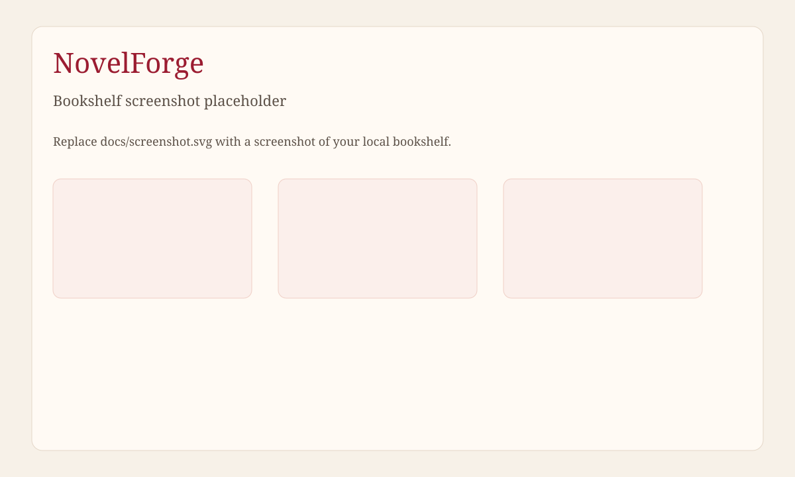

# NovelForge

NovelForge 是长篇小说写作工作台。人物卡、设定卡、伏笔和章节摘要都留在同一本书里，后面的章节不用把全书贴进对话框。

模型密钥自己准备。项目不代管模型，也不按套餐限制功能。

英文说明见 [README.md](README.md)。界面默认英文，可在页头切换到中文，选择记在浏览器 `localStorage` 的 `novelforge-locale`。



## 功能

书架、分卷和章节、人物卡和设定卡、记忆注入、伏笔提醒、流式生成、一致性检查、章节摘要、版本和回滚、导出、用量统计、模型设置（自备密钥）。

## 技术

Vue 3、Vite、Element Plus、vue-i18n 前端。Hono Worker。Drizzle 访问 D1。测试用 Node.js 自带的 `node:test`。

## 架构

浏览器只把 `/api/*` 交给 Worker，其余是 `dist/` 里的静态页面。写作数据在 D1，表名用 `cj_` 前缀，按登录用户隔离。

生成章节的接口返回 NDJSON 流（上下文、思考、正文增量、结束或错误）。浏览器断开后，Worker 仍会把已经得到的正文存成草稿。

密钥可以加密存在服务器上（`ENCRYPTION_KEY` 经 SHA-256 后做 AES-256-GCM，密文以 `enc:v1:` 开头），也可以只留在这台浏览器里。只留在浏览器时，调用模型的请求会带上 `X-Provider-Keys`，服务器不写入数据库。

空库的第一个注册账号是管理员。`ALLOW_REGISTRATION` 为 `false`、`0`、`no` 或 `off` 时，之后不能再注册。注册不需要额外的码。

## 本地运行

需要 Node.js 22 或更高版本。

```bash
npm install
cp .dev.vars.example .dev.vars
npm run build
npx wrangler d1 migrations apply DB --local
npm run dev
```

`.dev.vars` 里的 `JWT_SECRET` 和 `ENCRYPTION_KEY` 至少 16 位，不要提交。`wrangler.jsonc` 里的 `database_id` 是占位符 `<your-d1-database-id>`，部署前换成 `npx wrangler d1 create novelforge` 给出的 id。绑定名是 `DB`，库名是 `novelforge`。

## 部署

```bash
npx wrangler d1 create novelforge
npx wrangler d1 migrations apply DB --remote
npx wrangler secret put JWT_SECRET
npx wrangler secret put ENCRYPTION_KEY
npm run build
npx wrangler deploy
```

配置表、流式细节和测试说明以英文 README 为准。

## 许可

[MIT](LICENSE)。Copyright (c) 2026 Long Xiang.
