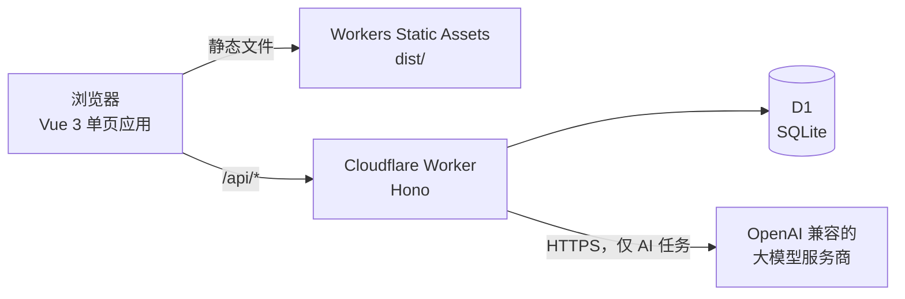

# NovelForge

**AI 辅助的长篇小说写作工作台。它替你记住整本书，不用再把前文贴进对话框。**

[English](README.md)


连载小说动辄几百章。用聊天式 AI 写作时，它常常忘了谁在第 9 章已经死了、主角现在是什么境界、哪些伏笔还没回收。NovelForge 把这些都存在书里：人物卡、设定卡、记忆、伏笔和章节摘要。写下一章时，相关内容会自动放进提示词，每一章也可以对照前文做一致性检查。

NovelForge 是一个更大的写作应用的社区版，采用 MIT 许可。模型密钥由你自己提供（OpenAI 兼容接口）。项目不托管模型，没有会员套餐，也不按套餐限制功能。

<!--
## 截图


-->

## 功能

**写作**
- 书架、分卷和章节，外加世界观设定，以及全书、分卷、章节三级大纲
- 流式生成章节（NDJSON）；浏览器中途断开，已生成的部分也会存成草稿
- 和 AI 聊这本书，一键应用它的建议，或者直接从对话建出一本新书（分卷、细纲、卡片）
- 阅读模式和书内全文搜索

**故事记忆**
- 人物卡和设定卡，每张卡都有修改历史
- 每章写完后提取记忆库改动，确认之后才会保存
- 伏笔追踪，临近计划回收的章节时会提醒
- 自动生成章节摘要

**质量保障**
- 一致性检查：找出和前文矛盾的地方，并定位到段落
- 埋错测试集（自带示例），用来衡量检查器能抓出多少问题
- 章节和卡片的版本管理与回滚

**数据和账号**
- 单章导出为文本，整本书导出为 zip（Markdown 正文，加上 YAML 格式的大纲、记忆库、伏笔和摘要）
- 每本书的数据统计
- 开放注册；第一个注册的账号是管理员，`ALLOW_REGISTRATION=false` 可关闭注册
- 界面默认英文，可在语言切换里改成简体中文

## 技术栈

| 层 | 技术 |
| --- | --- |
| 前端 | Vue 3、Vite、Vue Router、Element Plus、vue-i18n |
| 后端 | Cloudflare Workers 上的 Hono |
| 数据库 | Cloudflare D1（SQLite）+ Drizzle ORM |
| 托管 | Workers Static Assets 托管 Vite 构建产物 |
| 测试 | Node.js 自带测试运行器（`node:test`）+ Miniflare |

## 架构



- 只有 `/api/*` 会进入 Worker（见 `wrangler.jsonc` 里的 `run_worker_first`），其他路径都是静态文件，找不到时回退到 `index.html`。
- 写作数据存在 D1，表名统一用 `cj_` 前缀，每一行都按登录用户隔离。
- `POST /api/changjuan/chapters/:id/generate` 以 NDJSON 流返回事件：先是 `context`，然后是 `reasoning` 和 `delta` 增量，最后是 `done` 或 `error`。客户端断开后，Worker 会继续读完模型输出，并把已有内容存为草稿。
- 认证：密码用 PBKDF2-SHA256 哈希（50,000 次迭代），登录令牌是有效期 14 天的 HS256 JWT，登录有内存限流。

## 快速开始

**前置条件：** Node.js 22 或更高版本。只有部署时才需要 Cloudflare 账号。

```bash
git clone https://github.com/longxiang-io/novelforge.git
cd novelforge
npm install

# 本地密钥。把 JWT_SECRET 和 ENCRYPTION_KEY 改成随机字符串（至少 16 位）：
#   node -e "console.log(require('crypto').randomBytes(32).toString('hex'))"
cp .dev.vars.example .dev.vars

# 建本地 D1 数据库表（不需要 Cloudflare 账号）
npm run db:migrate:local

# 先构建前端，再在本地启动 Worker
npm run build
npm run dev
```

`npm run dev` 运行的是 `wrangler dev --local`，同时提供 API 和 `dist/` 里的页面（默认地址 http://localhost:8787）。改了前端之后要重新 `npm run build`。

在应用里注册第一个账号，它会成为管理员。然后打开 **设置**，添加模型服务商和密钥。

| 脚本 | 作用 |
| --- | --- |
| `npm run dev` | 本地运行 Worker 和静态资源（`wrangler dev --local`） |
| `npm run build` | 用 Vite 构建到 `dist/` |
| `npm test` | 用 `node --test` 运行 `test/` 下的全部测试（本地 Miniflare D1，不联网） |
| `npm run db:migrate:local` | 把 `migrations/` 应用到本地 D1 数据库 |

## 部署到 Cloudflare

1. 创建数据库，把输出的 id 填进 `wrangler.jsonc` 的 `d1_databases[0].database_id`（绑定名保持 `DB`）：
   ```bash
   npx wrangler d1 create novelforge
   ```
2. 对远程数据库执行迁移：
   ```bash
   npx wrangler d1 migrations apply DB --remote
   ```
3. 设置密钥：
   ```bash
   npx wrangler secret put JWT_SECRET
   npx wrangler secret put ENCRYPTION_KEY
   ```
4. 构建并部署：
   ```bash
   npm run build
   npx wrangler deploy
   ```

如果只想自己用，注册好自己的账号后，把 `ALLOW_REGISTRATION` 设为 `false`（在 `wrangler.jsonc` 或 Cloudflare 控制台里改）。

## 配置

| 名称 | 位置 | 必填 | 说明 |
| --- | --- | --- | --- |
| `JWT_SECRET` | `.dev.vars` / `wrangler secret put` | 是 | 签发登录令牌，至少 16 位。 |
| `ENCRYPTION_KEY` | `.dev.vars` / `wrangler secret put` | 是 | 加密保存在服务器上的模型密钥，至少 16 位。 |
| `ALLOW_REGISTRATION` | `wrangler.jsonc` 的 `vars`（本地可用 `.dev.vars` 覆盖） | 否 | 默认 `true`。设为 `false`、`0`、`no` 或 `off` 后，已有用户时不再开放注册。空库始终可以注册第一个管理员。 |
| `database_id` | `wrangler.jsonc` | 部署时必填 | `wrangler d1 create` 给出的 D1 数据库 id。 |

不要提交 `.dev.vars`，它已经在 `.gitignore` 里。

## 项目结构

```text
novelforge/
├── src/            # Vue 3 应用：页面、路由、语言包（en、zh-CN）、组件
├── worker/         # Hono Worker：index.js、routes.js、auth.js
│   ├── api/        # 一个接口一个文件，例如 chapters/[id]/generate.post.js
│   └── lib/        # 模型调用、提示词、检查器、记忆库、加密、导出
├── shared/         # 前端和 Worker 共用的代码
├── migrations/     # D1 SQL 迁移
├── test/           # node:test 测试
├── public/         # 静态资源（图标、头像）
├── wrangler.jsonc  # Worker、静态资源和 D1 配置
└── vite.config.js
```

## 自备密钥与隐私

每个用户可以在设置里添加最多 5 个 OpenAI 兼容的服务商，并为每项任务（生成正文、一致性检查、提取记忆、章节摘要、和 AI 聊）单独选模型。火山方舟（Volcengine Ark）有现成的预设。每个服务商的密钥可以选择存放位置：

- **存在服务器上：** 用 AES-256-GCM 加密（AES 密钥由 `ENCRYPTION_KEY` 经 SHA-256 得到）。接口只返回是否已设置密钥，以及末 4 位。
- **只存在这台浏览器里：** 密钥留在 `localStorage`，每次调用模型时通过 `X-Provider-Keys` 请求头发送。Worker 只在这次请求里使用，不会写入 D1。

只有在你运行 AI 任务时，稿件才会发给你配置的服务商。NovelForge 本身没有统计分析，也不调用其他第三方服务。

## 路线图

- [ ] 管理员页面，用来禁用账号（被禁用的账号已经无法登录，但目前还没有设置它的界面）
- [ ] 把剩下的中文模型提示词、任务和分类名称、接口错误信息翻译成英文

## 参与贡献

欢迎提 Issue 和 Pull Request。提交 PR 前请先运行 `npm test` 和 `npm run build`，改动尽量聚焦，新增的界面文字请在 `src/locales/` 下同时补上中英文。

## 许可

[MIT](LICENSE) © 2026 Long Xiang（[@longxiang-io](https://github.com/longxiang-io)）
